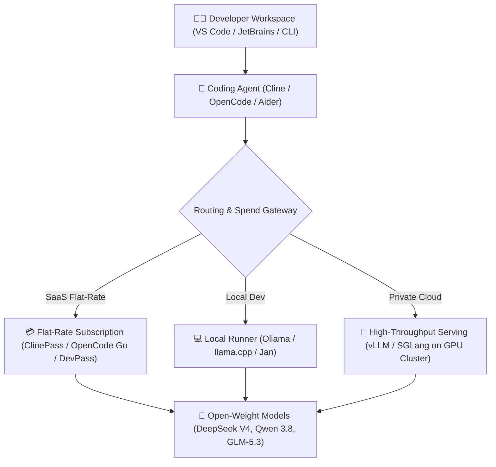

  

  
  
  
  
  
  
  

---

# 🚀 Awesome Subscriptions for Open-Weight Models

> **Curated directory of SaaS subscription platforms, flat-rate inference gateways, and open-source infrastructure for open-weight AI models (DeepSeek, Qwen, GLM, Kimi, MiMo, and Llama).**

A community-maintained guide to escaping per-token billing anxiety. These services deliver predictable monthly flat-rate plans and self-hosted runtimes tailored for **agentic coding workflows**, high-throughput developer inference, and private enterprise deployments — offering **2× to 5× greater token value** compared to standard metered API pricing.

---

## 📑 Table of Contents

- [📊 Sector Overview & Market Dynamics](#-sector-overview--market-dynamics)
- [💳 SaaS / Hosted Platforms Matrix](#-saas--hosted-platforms-matrix)
  - [🔍 Deep-Dive: Hosted Platform Profiles](#-deep-dive-hosted-platform-profiles)
- [🛠️ Open-Source GitHub Projects](#️-open-source-github-projects)
  - [⚡ Top Open-Source Repositories (Ranked by Stars)](#-top-open-source-repositories-ranked-by-stars)
- [🏗️ Architectural Guide: Building Your Stack](#️-architectural-guide-building-your-stack)
- [❓ Frequently Asked Questions (FAQ)](#-frequently-asked-questions-faq)
- [🤝 How to Contribute](#-how-to-contribute)
- [📈 Star History](#-star-history)
- [💖 Support & Sponsorship](#-support--sponsorship)
- [⚖️ Disclaimer & License](#️-disclaimer--license)

---

## 📊 Sector Overview & Market Dynamics

The global market for AI model access, inference hosting, and agentic coding tooling is projected to grow from **$12.8 Billion in 2024 to over $78.5 Billion by 2030** (CAGR ~35.4%). Within this landscape, open-weight model serving and flat-rate inference subscriptions represent the fastest-growing developer subsegment as engineering teams mitigate unpredictable per-token frontier model costs.

The sector currently exhibits **moderate to high fragmentation**:
- **Consumer Search & Aggregation:** Moderately concentrated around category leaders (Perplexity, Poe) offering multi-model prompt interfaces.
- **Developer & Agentic Workflows:** Highly fragmented across agile startups (ClinePass, OpenCode, DevPass, Synthetic.new), specialized TEE compute providers (Chutes), and independent model creators (Nous Research). The proliferation of high-performance coding models (DeepSeek V4, Qwen 3.8 Max, GLM-5.3) has prevented a single "winner-take-all" outcome, catalyzing healthy price competition, OpenAI-compatible proxy standards, and community-driven self-hosting alternatives.

---

## 💳 SaaS / Hosted Platforms Matrix

The table below compiles leading hosted platforms offering predictable subscriptions, flat-rate tiers, and token allowances for open-weight models. **Sorted descending by Company Size / Estimated Valuation.**

| 🏢 Company & Valuation | 🏷️ Platform | 💰 Starting Tier Pricing | 🎁 Free Tier & Trial Limits | 🧠 Top Models Supported | 🎯 Best For |
| :--- | :--- | :--- | :--- | :--- | :--- |
| **Perplexity AI** `~$9B – $18B Valuation` | [Perplexity Pro](https://www.perplexity.ai/) | **$20.00 / month** *(or $200 / yr)* | **Free-forever plan**: 5 Pro searches every 4 hrs + unlimited Quick search queries on open/standard models | DeepSeek V4, Llama 3.3 70B, Sonar, Qwen | Research, web citation synthesis & multimodal queries |
| **Quora (Poe)** `~$500M Valuation` | [Poe](https://poe.com/) | **$4.99 / month** *(10K compute pts/day)* | **Free-forever plan**: 3,000 compute points daily (resets every 24h) for open-weight chatbots | Qwen 2.5/3, DeepSeek V3/V4, Llama 3, Mistral | Consumer multi-bot experimentation & quick prompts |
| **Abacus.ai** `~$250M – $300M Valuation` | [Abacus.ai](https://abacus.ai/) | **$20.00 / month** *(30K credits + unlimited)* | **14-day free trial**: $50 credit grant (up to 5,000 queries) upon corporate email verification | GLM-5.3 Flash, DeepSeek V4 Pro, MiMo V2.6, Kimi K2.7 | Cloud agent sandboxes, SuperComputer & enterprise pipelines |
| **Nous Research** `~$70M – $100M Valuation` | [Nous Portal](https://portal.nousresearch.com/) | **$20.00 / month** *(Standard Tier)* | **Free-forever plan**: 50 daily requests on Hermes-4 open models; $5 sign-up credit valid 30 days | Hermes-4, GLM series, Qwen3, OpenRouter catalog | Autonomous Hermes agent cloud hosting & tool gateway |
| **Anomaly (OpenCode)** `~$25M – $50M Valuation` | [OpenCode Go](https://opencode.ai/en/go) | **$10.00 / month** *(Go Plan; $40 Go Plus)* | **Free client + 3-day trial**: CLI 100% free with BYOK; Go tier offers 3-day free trial (150 reqs/day) | GLM-5.3, Kimi K3, DeepSeek V4 Pro, Qwen3.8 Max | Terminal-native autonomous coding agent workflows |
| **Cline Bot Inc.** `~$15M – $25M Valuation` | [ClinePass](https://docs.cline.bot/getting-started/clinepass) | **$9.99 / month** *(Flat monthly rate)* | **Free client + 7-day trial**: Extension 100% free with BYOK; 7-day trial with 100 daily requests | GLM-5.3, DeepSeek V4 Pro/Flash, Kimi K3, MiMo-V2.5 | VS Code / JetBrains agentic pair programming |
| **LLM Gateway Inc.** `~$10M Valuation / $2M ARR` | [DevPass](https://devpass.llmgateway.io/pricing) | **$29.00 / month** *(Converts to $87 usage)* | **Free tier + 7-day guarantee**: 100 free requests/mo on open models; 7-day unconditional refund period | DeepSeek V4, Qwen 3.8, GLM, Kimi, Claude, GPT-5 | Developers needing 3× purchasing power across 200+ models |
| **Synthetic Technologies** `~$8M – $12M Valuation` | [Synthetic.new](https://synthetic.new/pricing) | **$30.00 / month** *($1 / day flat rate)* | **7-day free trial**: 50 requests per 5 hours upon verified signup; free embeddings permanently | DeepSeek V4, Qwen 3.7/3.8, GLM-5.3, MiMo-V2.5 | Heavy multi-turn coding agent loops (500 req / 5 hrs) |
| **Chutes.ai** `~$6M – $10M Valuation` | [Chutes](https://chutes.ai/pricing) | **$0.0245 / 1M tokens** *(Min $5 wallet deposit)* | **100,000 free tokens**: One-time grant on account creation valid 30 days; test models at zero cost | Qwen3-32B, GLM-5.2, Kimi K3, Mistral-Nemo | Pay-as-you-go confidential TEE GPU compute |
| **Command Code Inc.** `~$3M – $5M Valuation` | [Command Code Go](https://commandcode.ai/docs/plans/go) | **$1.00 / month** *($3 usage / 5 hrs)* | **Free-forever plan**: 25 requests/day on GLM-5.2 Flash and DeepSeek Fast models | GLM-5.3 Flash, Kimi K2.7 Code, DeepSeek V4 Flash | Budget-conscious developers & international builders |
| **NanoGPT Group** `~$2M – $4M Valuation` | [NanoGPT](https://nano-gpt.com/subscription) | **$12.00 / month** *(60M input tokens/wk)* | **Free faucet account**: 1,000 free tokens on signup + 500 daily faucet tokens for open models | GLM 5.3, MiMo V2.5 Pro, DeepSeek V4, MiniMax M3 | Privacy-first zero-data-retention (ZDR) anonymous API |

---

### 🔍 Deep-Dive: Hosted Platform Profiles

#### 1. 🌟 [Perplexity Pro](https://www.perplexity.ai/)
- **Pricing:** $20.00/month or $200.00/year. Enterprise plan at $40.00/user/month.
- **Free Allowance:** Free accounts receive 5 Pro searches every 4 hours alongside unlimited Standard searches powered by open models.
- **Why It Matters:** Combines live search grounding with open-weight frontier checkpoints (DeepSeek, Llama 3.3, Qwen) for synthesized research reports.

#### 2. 💬 [Poe (by Quora)](https://poe.com/)
- **Pricing:** $4.99/month (10,000 daily points) up to $19.99/month (1,000,000 monthly points). Additional packs at $30 per 1M compute points.
- **Free Allowance:** 3,000 compute points replenished every 24 hours.
- **Why It Matters:** Excellent playground for testing multiple open-weight and proprietary models in parallel through iOS, Android, Web, and bot APIs.

#### 3. 🧪 [Abacus.ai SuperComputer](https://abacus.ai/)
- **Pricing:** $20.00/month includes 30,000 monthly credits with unlimited queries on RouteLLM, GLM-5.3 Flash, DeepSeek V4 Flash/Pro, and MiMo V2.6.
- **Free Allowance:** 14-day free trial with $50 platform credit grant on corporate email registration.
- **Why It Matters:** Provides an always-on cloud environment with integrated code execution, agent orchestration, and automated pipeline deployment.

#### 4. 🦅 [Nous Portal (Nous Research)](https://portal.nousresearch.com/)
- **Pricing:** $20.00/month standard tier. Hosted Hermes Cloud with dedicated instances available.
- **Free Allowance:** 50 requests/day on Hermes open models; $5 trial credits valid for 30 days.
- **Why It Matters:** First-party home of Hermes-4 and Nous fine-tunes, bundled with a versatile Tool Gateway for web search, sandbox code execution, and multimodal pipelines.

#### 5. ⚡ [OpenCode Go](https://opencode.ai/en/go)
- **Pricing:** Go Plan at $10.00/month; Go Plus Plan at $40.00/month for heavier multi-agent concurrency.
- **Free Allowance:** Core terminal CLI is 100% open-source and free with BYOK. Go subscription includes a 3-day trial (150 requests/day).
- **Why It Matters:** Tailored explicitly for OpenCode terminal agent workflows, maintaining direct low-latency tunnels to open-weight coding models.

#### 6. 🤖 [ClinePass](https://docs.cline.bot/getting-started/clinepass)
- **Pricing:** $9.99/month flat subscription — no metered per-token surcharge.
- **Free Allowance:** Extension is 100% free with BYOK; 7-day trial with 100 requests/day before first subscription invoice.
- **Why It Matters:** Seamlessly plugs into Cline (VS Code / JetBrains / CLI) providing high-throughput access to GLM-5.3, DeepSeek V4 Pro, and Qwen3.8 Max.

#### 7. 🌉 [DevPass by LLM Gateway](https://devpass.llmgateway.io/pricing)
- **Pricing:** Lite tier at $29.00/month ($87 usage value), Pro at $79.00/month ($237 usage value), Max at $179.00/month ($537 usage value).
- **Free Allowance:** Free tier with 100 requests/month across open models; 7-day money-back guarantee.
- **Why It Matters:** Multi-provider gateway delivering 3× effective value on model calls across 200+ models, with real-time per-request cost analytics.

#### 8. 🔄 [Synthetic.new](https://synthetic.new/pricing)
- **Pricing:** $30.00/month ($1.00/day).
- **Free Allowance:** 7-day trial with 50 requests per 5 hours upon verified signup; embedding models free indefinitely.
- **Why It Matters:** Offers 500 requests per 5 hours across all supported open-weight models, making it ideal for persistent autonomous coding agents.

#### 9. 🛡️ [Chutes](https://chutes.ai/pricing)
- **Pricing:** Pure pay-per-token from $0.0245/1M tokens (Mistral-Nemo), $0.104/1M (Qwen3-32B), $0.98/1M (GLM-5.1). Dedicated GPUs from $1.80/hour. Min deposit $5.
- **Free Allowance:** 100,000 free tokens upon signup valid for 30 days.
- **Why It Matters:** Decentralized, confidential TEE (Trusted Execution Environment) compute on Bittensor with zero markup and cryptographic verification.

#### 10. 🎯 [Command Code Go](https://commandcode.ai/docs/plans/go)
- **Pricing:** $1.00/month for international developers ($3 usage per 5 hours, $6/week, $10/month cap).
- **Free Allowance:** Free tier with 25 requests/day on GLM-5.2 and DeepSeek Flash models.
- **Why It Matters:** The most affordable managed entry point for developers seeking reliable coding model endpoints in developing markets.

#### 11. 🔒 [NanoGPT](https://nano-gpt.com/subscription)
- **Pricing:** $12.00/month (includes 60 million input tokens per week + 5% discount on paid models).
- **Free Allowance:** 1,000 free tokens on signup + 500 tokens/day free faucet.
- **Why It Matters:** Zero data retention (ZDR), privacy-first cryptocurrency micropayments (Nano, Bitcoin Lightning), and uncensored open model support.

---

## 🛠️ Open-Source GitHub Projects

For engineers preferring full autonomy, self-hosting, and zero recurring vendor fees, the open-weight ecosystem provides industry-standard runtimes, serving engines, and coding agents.

### ⚡ Top Open-Source Repositories (Ranked by Stars)

Each repository is linked directly, complete with its real-time social Stars_Badge linking to its Stargazers community:

1. **[OpenCode](https://github.com/anomalyco/opencode)**   
   *Terminal-native autonomous AI coding agent.* Free with BYOK across 75+ providers with SSH, git integration, and multi-turn refactoring loops. MIT licensed.

2. **[Ollama](https://github.com/ollama/ollama)**   
   *Get up and running with Llama, DeepSeek, Qwen, and Mistral locally.* Simple CLI and OpenAI-compatible HTTP daemon for macOS, Linux, and Windows. MIT licensed.

3. **[Dify](https://github.com/langgenius/dify)**   
   *Production-ready LLM application development platform.* Visual orchestration for multi-agent workflows, RAG pipelines, and open-weight model routing. Apache 2.0 licensed.

4. **[Open WebUI](https://github.com/open-webui/open-webui)**   
   *Extensible, self-hosted web interface for LLMs.* Seamless integration with Ollama, vLLM, and OpenAI-compatible backends featuring RAG and multimodal support. Open-source.

5. **[llama.cpp](https://github.com/ggml-org/llama.cpp)**   
   *LLM inference in C/C++.* The pioneer of quantized GGUF execution on Apple Silicon, CPU, and consumer GPUs with zero third-party dependencies. MIT licensed.

6. **[vLLM](https://github.com/vllm-project/vllm)**   
   *High-throughput and memory-efficient LLM serving engine.* Powered by PagedAttention, continuous batching, and tensor parallelism. The gold standard for enterprise serving. Apache 2.0 licensed.

7. **[LLaMA-Factory](https://github.com/hiyouga/LLaMA-Factory)**   
   *Unified efficient fine-tuning framework.* Supports 100+ open-weight LLMs with LoRA, QLoRA, DPO, and PPO via command-line and web UI. Apache 2.0 licensed.

8. **[Cline](https://github.com/cline/cline)**   
   *Autonomous coding agent extension for VS Code and JetBrains.* Features MCP (Model Context Protocol) tool integration, human-in-the-loop file edits, and terminal execution. Apache 2.0 licensed.

9. **[LiteLLM](https://github.com/BerriAI/litellm)**   
   *Universal I/O proxy for 100+ LLMs.* Translates OpenAI-format calls to vLLM, Ollama, HuggingFace, and cloud APIs with load balancing, rate limiting, and spend tracking. MIT licensed.

10. **[Goose](https://github.com/aaif-goose/goose)**   
    *Rust-based extensible developer agent by Block (Agentic AI Foundation).* Desktop app, CLI, and API with extensive MCP extension support. Apache 2.0 licensed.

11. **[Aider](https://github.com/Aider-AI/aider)**   
    *Terminal pair programming in git repositories.* Builds an in-memory codebase map, auto-edits files, auto-commits git diffs, and self-corrects using test output. Apache 2.0 licensed.

12. **[LocalAI](https://github.com/mudler/LocalAI)**   
    *Drop-in self-hosted OpenAI alternative.* Runs LLMs, audio transcription, image generation, and embeddings locally on commodity hardware without cloud telemetry. MIT licensed.

13. **[Text Generation WebUI](https://github.com/oobabooga/text-generation-webui)**   
    *Gradio web UI for large language models.* Supports Transformers, GPTQ, AWQ, EXL2, and llama.cpp backends with extensive LoRA inspection and chat modes. AGPL 3.0 licensed.

14. **[Jan](https://github.com/janhq/jan)**   
    *Self-hosted open-source alternative to ChatGPT.* Clean desktop client that runs 100% offline on consumer hardware with local API server and hardware acceleration. AGPL 3.0 licensed.

15. **[SGLang](https://github.com/sgl-project/sglang)**   
    *Fast serving framework for complex LLM programs.* RadixAttention enables high-speed KV cache reuse across multi-turn prompts and agentic workflows. Apache 2.0 licensed.

16. **[Continue](https://github.com/continuedev/continue)**   
    *Open-source AI code assistant for VS Code and JetBrains.* Connects custom models (local Ollama or remote vLLM) for inline tab autocomplete, codebase chat, and refactoring. Apache 2.0 licensed.

17. **[Tabby](https://github.com/TabbyML/tabby)**   
    *Self-hosted AI coding assistant.* Independent alternative to GitHub Copilot with full repository indexing, multi-language completion, and on-premise security. Apache 2.0 licensed.

18. **[Text Generation Inference (TGI)](https://github.com/huggingface/text-generation-inference)**   
    *Hugging Face's production-ready serving container.* Enterprise features including continuous batching, Flash Attention v2, speculative decoding, and tensor parallelism. Apache 2.0 licensed.

19. **[Xinference](https://github.com/xorbitsai/inference)**   
    *Distributed inference orchestration engine.* Deploy open LLMs, multimodal vision models, and embeddings across clusters with automated model downloading and CUDA/MPS acceleration. Apache 2.0 licensed.

20. **[ExLlamaV2](https://github.com/turboderp-org/exllamav2)**   
    *Extreme inference library for modern consumer GPUs.* Custom EXL2 quantization delivering maximum tokens-per-second throughput on NVIDIA hardware. MIT licensed.

---

## 🏗️ Architectural Guide: Building Your Stack

To achieve an optimal price-to-performance ratio without vendor lock-in, developers typically combine tools across three architectural tiers:

1. **Local Prototyping:** Run **Ollama** or **llama.cpp** on an M-series Mac or consumer RTX GPU for zero-cost rapid iterations.
2. **Heavy Multi-Turn Coding:** Route agents like **Cline** or **OpenCode** through flat-rate SaaS tiers (**ClinePass**, **OpenCode Go**, or **Synthetic.new**) to eliminate per-token bill shock.
3. **Enterprise Production:** Deploy **vLLM** or **SGLang** behind **LiteLLM** for internal company-wide governance, caching, and fallbacks.

---

## ❓ Frequently Asked Questions (FAQ)

<b>1. What is an "open-weight model" and how does it differ from open-source AI?</b>

Open-weight models (such as DeepSeek V4, Qwen 3.8, and GLM-5.3) make their trained neural network weights publicly accessible for download and self-hosting. While some release code under permissive licenses (Apache 2.0 or MIT), others include acceptable-use policies. This contrasts with closed proprietary models (like OpenAI GPT-5 or Anthropic Claude) which can only be reached via metered proprietary APIs.

<b>2. Why choose a flat-rate subscription over standard pay-per-token API endpoints?</b>

Autonomous coding agents consume tens of thousands of tokens per minute during iterative edit-compile-test cycles. Standard token billing creates financial unpredictability and throttling anxiety. Flat-rate platforms (like ClinePass, Synthetic.new, or OpenCode Go) provide predictable monthly expenses and often offer 2× to 5× the effective token volume per dollar compared to provider retail list prices.

<b>3. Can I use these subscriptions in third-party IDE extensions?</b>

Yes! The majority of featured providers (DevPass, Synthetic.new, Nous Portal, ClinePass, OpenCode) expose standard OpenAI-compatible API base URLs. You can plug their endpoint and API key into Cline, Cursor, Roo Code, Aider, Continue, or custom Python/TypeScript scripts.

<b>4. Which open-weight models perform best on agentic coding benchmarks?</b>

As of 2026, the leading open-weight coding models include <b>DeepSeek V4 Pro / Flash</b>, <b>Qwen 3.8 Max / 3.7 Plus</b>, <b>GLM-5.3</b>, and <b>Kimi K3</b>. These models consistently score within 2–5% of frontier proprietary models on SWE-bench and HumanEval while executing at significantly higher tokens-per-second.

---

## 🤝 How to Contribute

We welcome community contributions! To add a new platform, update pricing, or list an open-source project:

1. 🍴 **Fork** this repository.
2. 📝 **Edit `README.md`** following the existing format:
   - For SaaS: Include name, link, company size/valuation, specific starting tier pricing, specific free tier/trial limits, and top supported models.
   - For Open-Source: Include repository link, social Stars_Badge linking to `/stargazers`, and 1–2 sentence description.
3. 🚀 **Submit a Pull Request** with a clear description and official source references.

Check out our sister repository: [Awesome-Awesome-Awesome](https://github.com/ishandutta2007/Awesome-Awesome-Awesome) for more curated tech collections!

---

## 📈 Star History

---

## 💖 Support & Sponsorship

Thank you for visiting and supporting the open-weight model ecosystem! Building and maintaining high-quality, up-to-date curated resources requires continuous research and community validation.

If you find this repository valuable:
- ⭐ **Star this repository** to help others discover it.
- 🍴 **Fork and share** with your developer network.
- ☕ **Sponsor or buy a coffee** to support ongoing maintenance via the [GitHub Sponsors Dashboard](https://github.com/sponsors/ishandutta2007).

Your support enables continuous updates, benchmarking, and tracking of new open-weight infrastructure!

---

## ⚖️ Disclaimer & License

- **Disclaimer:** This is an independent community-curated directory. Brand names, logos, and trademarks belong to their respective owners. Inclusion does not imply endorsement or commercial affiliation.
- **Licensing:** Distributed under the [MIT License](LICENSE).
